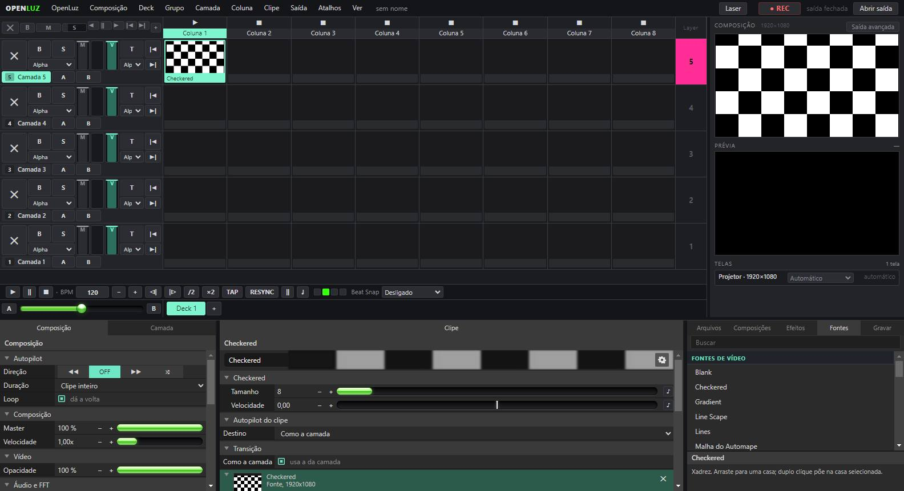
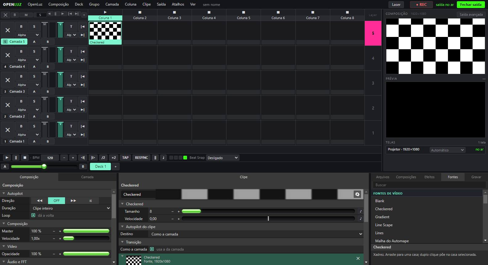
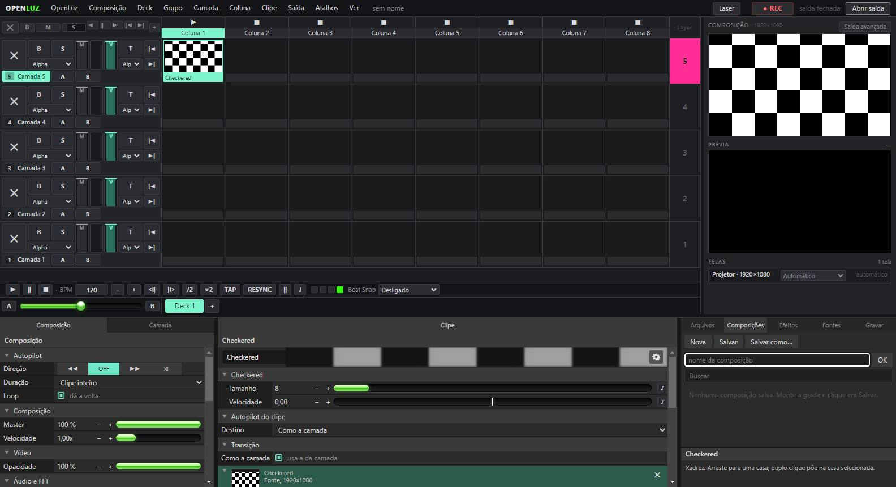

# OpenLuz: primeiros passos

[English below](#openluz-first-steps)

Do download até uma imagem no projetor, em uns cinco minutos. Vale para a versão **0.3.0-beta.2** no Windows 10 e 11 (64 bits).

## 1. Baixar e instalar

1. Abra a página de [versões](https://github.com/felipespencer/openluz/releases) e baixe o arquivo `.msi` da versão mais recente (cerca de 270 MB).
2. Abra o arquivo. O Windows mostra um aviso azul, "O Windows protegeu o computador", porque o instalador ainda não é assinado. Clique em **Mais informações** e depois em **Executar assim mesmo**.
3. Siga o instalador até o fim. Depois, procure **OpenLuz** no menu Iniciar.

## 2. Abrir

O programa abre com uma grade vazia: cinco camadas (as linhas) e oito colunas. Cada casa da grade guarda um clipe.

Se houver um segundo monitor ou um projetor ligado, na primeira vez aparece o assistente **Projetores**. Para começar, clique em **Pular**; ele continua disponível em **Saída › Projetores…**.

## 3. Pôr alguma coisa na grade

Há três jeitos; qualquer um serve:

- **Um vídeo ou uma imagem seus**: arraste o arquivo de uma pasta do Windows para uma casa da grade.
- **Pela aba Arquivos** (embaixo, à direita): entre em Vídeos, Imagens ou outra pasta e arraste o arquivo para uma casa.
- **Sem arquivo nenhum**: na aba **Fontes**, arraste **Checkered** (um xadrez) para uma casa. Serve para testar.

Colocar o clipe na casa ainda não o mostra: ele só fica guardado ali.

## 4. Pôr no ar

**Clique na casa.** O clipe vai para o ar e aparece no quadro **Composição**, em cima à direita.

- Clicar em outro clipe da mesma camada troca.
- O **✕** no começo da linha tira a camada do ar.
- Clipes em camadas diferentes aparecem um por cima do outro; a camada de cima fica na frente.

## 5. Mandar para o projetor

Clique em **Abrir saída**, em cima à direita. O botão passa a dizer **Fechar saída** e ao lado aparece "saída no ar".

- **Com um projetor ligado** como segunda tela do Windows, a saída abre nele em tela cheia.
- **Só com a tela do computador**, a saída abre numa janela. Com ela na frente, **F** ou duplo clique alterna a tela cheia.

Para recortar, deformar ou juntar projetores, use **Saída avançada**, ao lado do quadro Composição.

## 6. Salvar

**Ctrl+S**. A aba **Composições** abre com um campo para o nome; escreva e clique em **OK**. Para voltar a ela outro dia, dê duplo clique no nome nessa mesma aba.

## Deu errado?

- **O programa fechou ou travou**: ele guarda um registro. Abra **OpenLuz › Abrir o registro de travamentos** e mande o arquivo junto com o relato.
- **Onde relatar**: [github.com/felipespencer/openluz/issues](https://github.com/felipespencer/openluz/issues). Diga o que você fez, o que esperava e o que aconteceu; uma foto da tela ajuda muito.
- **Passe o mouse** sobre qualquer botão: a caixa **Ajuda**, embaixo à direita, diz o que ele faz.

O que cada parte do programa faz está em [COMO-USAR.md](COMO-USAR.md).

---

# OpenLuz: first steps

From download to an image on the projector in about five minutes. For version **0.3.0-beta.2** on Windows 10 and 11 (64-bit). The interface is in Portuguese for now; the names below are the ones you will see on screen.

## 1. Download and install

1. Open the [releases](https://github.com/felipespencer/openluz/releases) page and download the `.msi` file of the latest version (about 270 MB).
2. Open the file. Windows shows a blue warning, "Windows protected your PC", because the installer is not signed yet. Click **More info**, then **Run anyway**.
3. Follow the installer to the end. Then look for **OpenLuz** in the Start menu.

## 2. Open

The app opens with an empty grid: five layers (rows) and eight columns. Each cell holds one clip.

If a second monitor or a projector is connected, the **Projetores** (Projectors) wizard appears the first time. To get started, click **Pular** (Skip); it stays available under **Saída › Projetores…**.

## 3. Put something in the grid

Any of these works:

- **Your own video or image**: drag the file from a Windows folder onto a cell.
- **From the Arquivos (Files) tab**, bottom right: go into Vídeos, Imagens or another folder and drag the file onto a cell.
- **With no file at all**: on the **Fontes** (Sources) tab, drag **Checkered** onto a cell. Good for a first test.

Placing a clip in a cell does not show it yet; it is only stored there.

## 4. Take it live

**Click the cell.** The clip goes live and shows in the **Composição** (Composition) monitor, top right.

- Clicking another clip in the same layer switches to it.
- The **✕** at the start of the row takes the layer off air.
- Clips in different layers stack; the top layer is in front.

## 5. Send it to the projector

Click **Abrir saída** (Open output), top right. The button changes to **Fechar saída** (Close output).

- **With a projector connected** as a second Windows display, the output opens on it in full screen.
- **With only the computer screen**, the output opens in a window. With it in front, **F** or a double-click toggles full screen.

To crop, warp or blend projectors, use **Saída avançada** (Advanced Output), next to the Composition monitor.

## 6. Save

**Ctrl+S**. The **Composições** tab opens with a name field; type a name and click **OK**. To come back to it later, double-click its name on that same tab.

## Something went wrong?

- **The app closed or froze**: it keeps a log. Open **OpenLuz › Abrir o registro de travamentos** and send the file with your report.
- **Where to report**: [github.com/felipespencer/openluz/issues](https://github.com/felipespencer/openluz/issues). Say what you did, what you expected and what happened; a screenshot helps a lot.
- **Hover** over any button: the **Ajuda** (Help) box, bottom right, says what it does.
